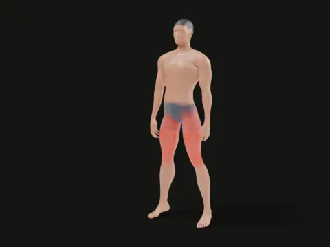
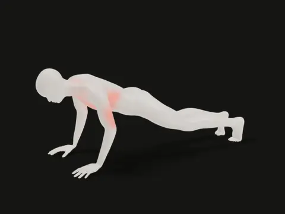
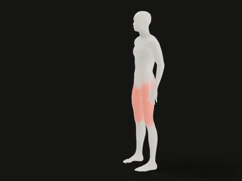

# FitCoach — Nutrición y entrenamiento en una sola app

[](https://github.com/FernandoJose25/fitcoach/actions/workflows/ci.yml)


App móvil gratuita que junta lo que hacen Fitia (dieta) y Simetri (gimnasio). A partir de tus datos te arma un **menú con platos peruanos** y una **rutina para gimnasio o casa**, te guía en cada serie y ajusta tus calorías según cómo progresas.

> **English summary:** Free mobile app combining a meal planner (Peruvian dishes) and a strength-training coach. pnpm monorepo with a pure, fully tested TypeScript domain core (calorie/macro engine, meal planning, workout splits, adaptive adjustments), an Expo/React Native client, and a Supabase backend with an Edge Function that uses an LLM vision model to analyze meal photos. Exercise demos are 3D animations I rendered in Blender.

<p align="center">
  
  
  
</p>
<p align="center"><sub>Algunas de las 50 animaciones de ejercicios que modelé y rendericé en Blender para la app.</sub></p>

## Mi rol

Proyecto personal **diseñado y construido por mí de punta a punta**: especificación de producto ([SPEC](docs/SPEC.md)), plan por fases ([PLAN](docs/PLAN.md)), dirección visual, lógica de dominio, app móvil, backend, contenido (alimentos, recetas y ejercicios) y animaciones 3D.

## Qué hace

**Nutrición**
- Onboarding de 10 pantallas que calcula calorías y macros según edad, peso, altura, objetivo, actividad y experiencia.
- Plan diario con **133 recetas** intercambiables y porciones que se escalan a tus metas. Respeta alergias y alimentos excluidos, y tiene opciones veganas y sin gluten.
- Registro de comidas por búsqueda (**690 alimentos, platos, bebidas y productos** de Perú), código de barras (catálogo propio, Open Food Facts, supermercados peruanos o foto de la etiqueta) y frecuentes.
- **Escáner de platos con IA:** tomas una foto y una Edge Function de Supabase identifica los alimentos y estima los gramos con un modelo de visión (Groq).
- Agua, lista de compras y recordatorios locales.
- **Ajuste adaptativo:** cada semana compara tu peso real con el esperado y propone ±100–150 kcal, con el motivo.

**Entrenamiento**
- Rutina por objetivo, nivel, lugar (gimnasio o casa) y días disponibles, con un split semanal.
- **Entreno guiado:** preparación → serie → descanso, con voz, vibración, pantalla siempre encendida y avisos en segundo plano.
- Registro de peso × repeticiones, récords personales, doble progresión y volumen semanal.
- Mapa anatómico de los músculos trabajados en la semana. Cada ejercicio se puede cambiar por otro equivalente.
- Progreso: peso con tendencia y proyección, medidas, fotos de antes y después, racha y 11 logros.

**Plataforma**
- Funciona sin conexión y sincroniza con Supabase (auth anónima, perfil, registros, series, peso).
- Sección "Aprende" que explica tu plan con tus propios números.
- Accesibilidad, estados de error y borrado de cuenta.

## Stack

| Capa | Tecnologías |
|---|---|
| Monorepo | pnpm workspaces, TypeScript estricto, ESLint, GitHub Actions |
| Dominio (`packages/core`) | TypeScript puro sin dependencias de UI, testeado con **Vitest** (40 tests) |
| App (`apps/mobile`) | React Native 0.88, Expo SDK 58, Expo Router, Zustand, Reanimated, expo-camera, expo-speech, expo-notifications |
| Backend (`supabase/`) | PostgreSQL con RLS, migraciones versionadas, Edge Function `scan-food` (Deno) con LLM de visión |
| Contenido 3D | Blender + MPFB: animaciones renderizadas a WebP con scripts de Python |
| Distribución | EAS Build (Android) |

## Arquitectura

```
packages/core     Lógica pura: calorías y macros, plan de comidas, rutinas y splits,
                  progresión de fuerza, ajuste adaptativo, veredicto del escáner.
                  100 % testeable, sin React ni red.
apps/mobile       Expo Router: (tabs) Hoy · Plan · Entreno · Aprende, más onboarding,
                  entreno guiado, escáner y progreso.
supabase          Migraciones 0001–0009, Edge Function scan-food y semillas de alimentos.
docs              Especificación, plan de ejecución, política de privacidad y ficha de Play Store.
```

Toda la lógica de negocio vive en `packages/core` y la app solo la consume. Así las reglas (por ejemplo, cuántas calorías ajustar o qué serie toca) se prueban con tests unitarios sin levantar un emulador.

## Correr el proyecto

Requisitos: Node 22+ y pnpm 11.

```bash
pnpm install
pnpm -w test                   # tests del dominio (Vitest)
pnpm -w typecheck              # tsc en todos los paquetes
pnpm -w lint                   # ESLint
pnpm --filter mobile start     # Metro / Expo Go
```

Para usar el backend, copia `apps/mobile/.env.example` a `apps/mobile/.env` con la URL y la anon key de tu proyecto Supabase, y aplica las migraciones de `supabase/migrations/`.

## Estado

Fases F0–F7 completas y F8 (beta cerrada en Android) en curso. El detalle está en [docs/PLAN.md](docs/PLAN.md).
